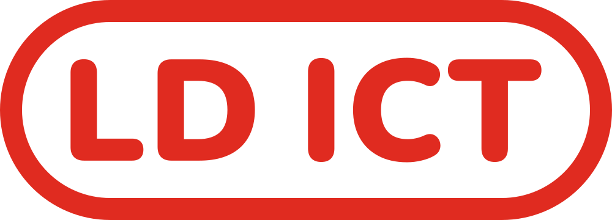

  <a href="https://www.ldict.nl">
    <picture>
      <source media="(prefers-color-scheme: dark)" srcset="./assets/ldict-logo-white.svg">
      
    </picture>
  </a>

<h3 align="center">Werkplek, zakelijke e-mail, webhosting en domeinen voor zzp'ers en kleine bedrijven, met je gegevens in Europa.</h3>

  <a href="https://www.ldict.nl"><b>ldict.nl</b></a> ·
  <a href="https://www.ldict.nl/online-werkplek">Werkplek</a> ·
  <a href="https://www.ldict.nl/prijzen">Prijzen</a> ·
  <a href="https://www.ldict.nl/contact">Contact</a> ·
  <a href="https://www.ldict.nl/en">English</a>

---

LD ICT bouwt en beheert de digitale basis voor ondernemers: van je eigen domein en een mailbox die gewoon werkt tot een complete werkplek waarin je team mailt, plant, samenwerkt en factureert. Alles draait op onze eigen platformen in Europa, zonder gedoe met losse abonnementen.

## Wat we maken

| | |
| --- | --- |
| 🧰 **[Werkplek](https://www.ldict.nl/online-werkplek)** | Eén plek voor je hele bedrijf, met apps die de bekende losse tools vervangen. |
| ✉️ **[Zakelijke e-mail](https://www.ldict.nl/zakelijke-email)** | Mail op je eigen domein, met open standaarden (IMAP, JMAP, SMTP), een lerend spamfilter en aliassen zoals `info@` en `factuur@`. |
| 🌐 **[Webhosting](https://www.ldict.nl/webhosting)** | Websites en apps van klanten, zelf gehost op Europese servers. |
| 🔗 **[Domeinen](https://www.ldict.nl/domeinen)** | Registreren, verhuizen en DNS beheren, zonder technische kennis. |

### De apps van de Werkplek

| Communicatie | Plannen | Samenwerken | Ondernemen |
| --- | --- | --- | --- |
| **Post** · e-mail | **Agenda** | **Kluis** · bestanden | **Kas** · boekhouding |
| **Slim** · AI-assistent | **Contacten** | **Pen** · documenten | **Uren** · tijdregistratie |
| **Praat** · chat | **Taken** | **Reken** · spreadsheets | **Studio** · je website |
| **Overleg** · videobellen | **Afspraak** · online boeken | **Toon** · presentaties | **Merk** · huisstijl |
| | | **Bord** · whiteboard | **Scherm** · narrowcasting |
| | | **Formulier** | **Koppelingen** |

Naast de SaaS-producten helpen we particulieren en bedrijven in de regio ook nog met IT-advies, installatie en reparatie.

## Hoe we bouwen

- **Snel en licht.** Pagina's die op een telefoon snel laden, met Lighthouse-checks op elke pull request.
- **Privacy eerst.** Gegevens blijven in Europa, geheimen alleen in server-side code, 2FA voor elk beheeraccount.
- **Open standaarden.** Je kiest zelf in welke app je mailt of agendeert, en je kunt altijd weer weg.
- **Nederlands voorop.** Onze klanten zijn Nederlands, dus de interface ook. Code en commits zijn in het Engels.

Next.js · React · TypeScript · HeroUI · Postgres (Neon) · Drizzle · Cloudflare · Vercel · Hetzner

## Contact

Ben je klant en heb je een vraag of storing? Neem dan contact op via [ldict.nl/contact](https://www.ldict.nl/contact) of mail [support@ldict.nl](mailto:support@ldict.nl). GitHub-issues zijn voor ons ontwikkelwerk, niet voor klantensupport. Een beveiligingsprobleem gevonden? Lees dan eerst ons [beveiligingsbeleid](https://github.com/LD-ICT/.github/blob/main/SECURITY.md).

<b>In English</b>

LD ICT is a Dutch company offering a workspace suite (Werkplek), business email, web hosting and domains to freelancers and small businesses, with all data hosted in Europe. Our user interfaces are in Dutch; code, issues and commit messages are in English. Customers can reach us at [ldict.nl/en](https://www.ldict.nl/en) or [support@ldict.nl](mailto:support@ldict.nl).

